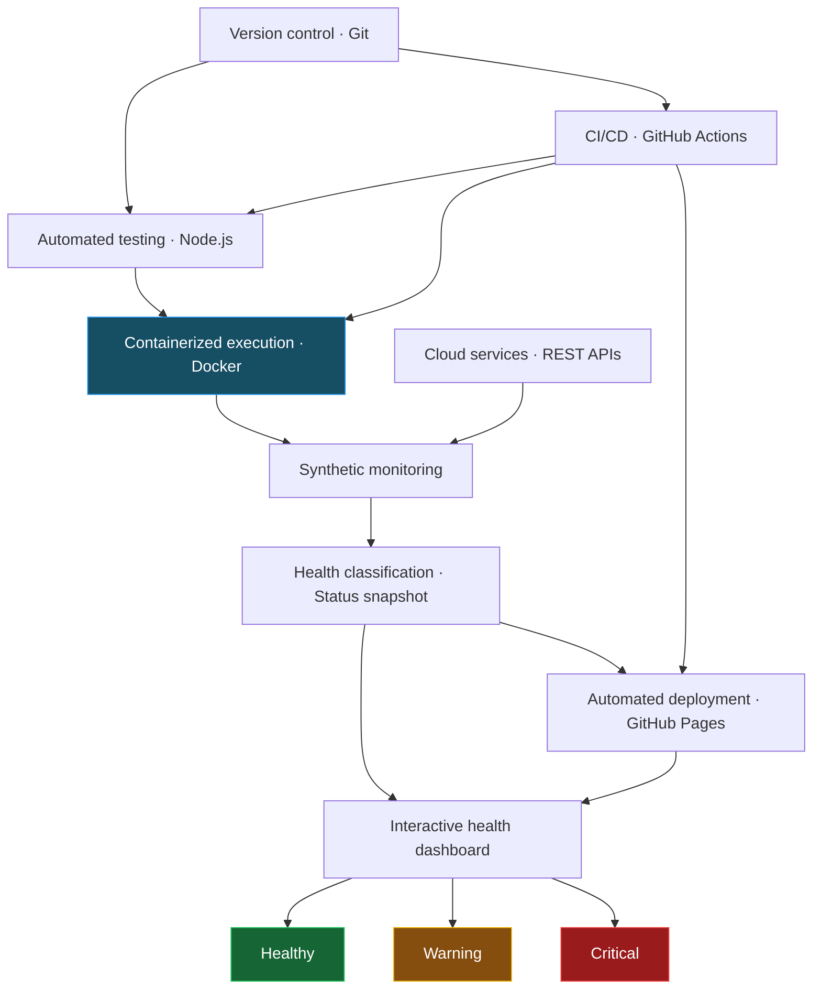

<p align="center">
  
</p>

<h1 align="center">Project Pulse</h1>
<p align="center"><strong>Status at a glance.</strong></p>
<p align="center">
  
  
  
</p>

A lightweight synthetic monitoring dashboard that transforms cloud service availability and API response times into a clear view of application health.

## Health indicators

| Status | Meaning |
| :--- | :--- |
| 🟢 **Healthy** | Successful checks within the performance threshold. |
| 🟡 **Warning** | Degraded performance, partial failure, overdue or incomplete monitoring data. |
| 🔴 **Critical** | Complete dependency check failure. |

## Features

- Containerized monitoring with Docker and non-root execution.
- Three-pulse sampling for availability and response-time analysis.
- Consistent health classification across dependencies, applications and the system.
- Interactive diagnostics with HTTP status codes and individual response times.
- Automatically refreshed results with live elapsed-time indicators.
- Automated tests for monitoring and health classification.
- Hourly monitoring and deployment through GitHub Actions and GitHub Pages.
- Freshness protection that flags results as overdue after two hours.

## How it works



Project Pulse separates monitoring execution from presentation, turning cloud measurements into a consistent view of application health. Automated tests validate the monitoring and classification logic.

GitHub Actions runs the monitoring worker hourly and supports manual execution. GitHub Pages serves the resulting dashboard; local execution uses the same monitoring worker and dashboard.

## Local development

Requires Node.js 22 or a compatible runtime. Docker is required for containerized execution.

```sh
npm test
npm run dev
```

Monitoring targets and credentials are configured separately from the dashboard.
