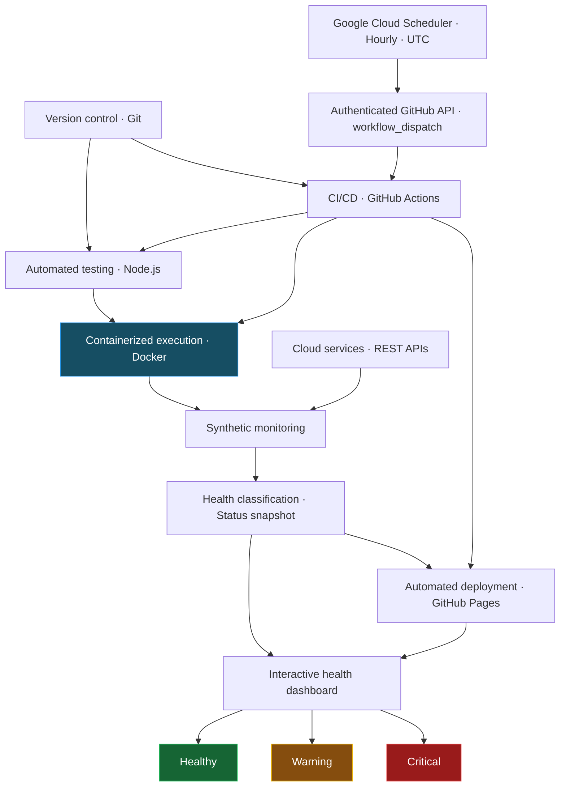

# Project Pulse

**"Status at a glance."**

A lightweight synthetic monitoring dashboard powered by a containerized monitoring worker, tracking cloud service availability, API response times and application health.

[**▶ LIVE DEMO**](https://jeps0n.github.io/project-pulse/) · [View Source](https://github.com/jeps0n/project-pulse)

## Health indicators

| Status | Meaning |
| :--- | :--- |
| 🟢 **Healthy** | Successful checks within the performance threshold. |
| 🟡 **Warning** | Degraded performance, partial failure, overdue or incomplete monitoring data. |
| 🔴 **Critical** | Complete dependency check failure. |

## Features

- Containerized monitoring with Docker and non-root execution.
- Three-pulse sampling for availability and response-time analysis.
- Consistent health classification across dependencies, applications and the system.
- Interactive diagnostics with HTTP status codes and individual response times.
- Automatically refreshed results with live elapsed-time indicators.
- Automated tests for monitoring and health classification.
- Hourly monitoring triggered by Google Cloud Scheduler, with execution and deployment through GitHub Actions and GitHub Pages.
- Freshness protection that flags results as overdue after two hours.

## How it works



Project Pulse separates monitoring execution from presentation, turning cloud measurements into a consistent view of application health. Automated tests validate the monitoring and classification logic.

Google Cloud Scheduler is configured to trigger the GitHub Actions workflow once every hour (UTC) using an authenticated GitHub REST API request. The workflow uses `workflow_dispatch` for both automated API requests and manual execution; native GitHub scheduling is disabled. The scheduler uses a repository-scoped fine-grained access token with Actions read/write permission; rotate it before expiration. GitHub Pages serves the resulting dashboard; local execution uses the same monitoring worker and dashboard.

## Tech Stack

- **Google Cloud Scheduler** — Managed scheduling
- **GitHub Actions** — Workflow automation and CI/CD
- **Docker** — Containerization
- **Node.js / JavaScript** — Monitoring engine
- **GitHub Pages** — Dashboard hosting

## Local development

Requires Node.js 20 or newer (Node.js 22 is used in CI and Docker). Docker is required for containerized execution.

```sh
npm test
npm run dev
```

Monitoring targets and credentials are configured separately from the dashboard.
